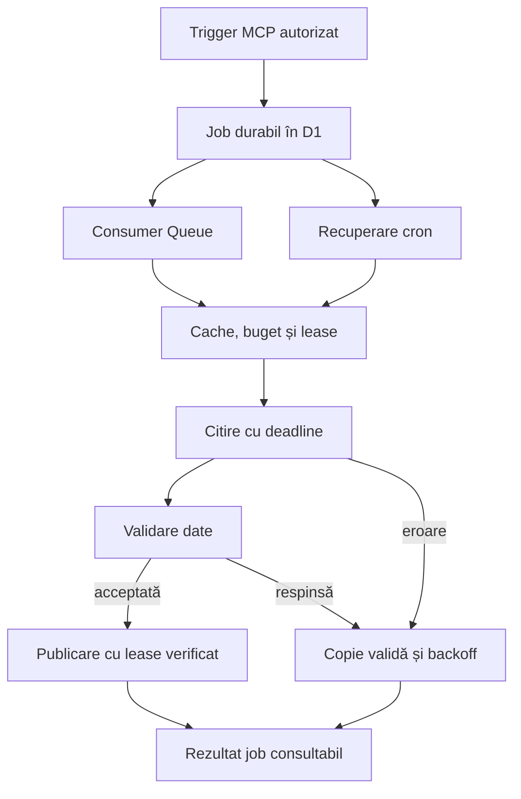

# Aflivra: audit și implementare pentru actualizarea fiabilă a datelor

Data: 11 octombrie 2026. Bază analizată: `e449f8b3b3d41eac09660d2183096bc760118e97` din `Brebu/aflivra`.

Platforma are o bază utilă: adaptoare distincte, proveniență, cache D1, copii validate, bugete și relay-uri pentru surse incompatibile cu egress-ul Workers. Defectul important era predictibilitatea actualizării: o cerere acceptată, un import reușit, o copie descărcată recent și cea mai nouă ediție publicată erau etape insuficient separate. Acest PR introduce joburi durabile, trigger-uri MCP private și verificări pentru concurență, fără a pretinde că schimbările sunt deja în producție.

## 1. Defecte și rezolvări concrete

| Prioritate | Problemă verificată în cod / execuție | Rezolvare în PR | Limită rămasă |
| --- | --- | --- | --- |
| P1 | Transportul retry trata răspunsuri 5xx, dar nu căderile temporare ale conexiunii; un fetch blocat nu era limitat de deadline-ul absolut. | Maximum trei încercări totale pentru erori temporare, 408/429/5xx, jitter, timeout absolut și păstrarea semnalului de anulare. | Certificatele invalide și DNS-ul permanent greșit necesită repararea originii/configurației. |
| P1 | Interogarea POST TEMPO folosea fetch direct, în afara timeout-ului și diagnosticului comun. | `insSeriesLoader` folosește `getSource`, cu retry pentru această interogare de citire. | Conectivitatea trebuie verificată și din mediul Workers. |
| P1 | Lease-ul de 60 s putea expira înaintea operațiilor cu mai multe apeluri; un worker întârziat putea suprascrie rezultatul altuia sau îi putea șterge lease-ul. | Lease de sursă de 300 s; publicarea și înregistrarea erorii sunt condiționate de lease-ul revendicat. Chunks nepublicate expiră; nu se șterg pe eroarea unui writer pierzător. | Importurile mai lungi de cinci minute necesită partiționare sau heartbeat într-o etapă ulterioară. |
| P1 | Actualizarea administrativă rula sincron și nu oferea un job persistent, observabil, recuperabil după întrerupere. | Outbox D1, UUID-uri, deduplicare atomică pe membru, lease pentru consumer, stare și istoric; Queue opțională, recuperare cron. | Activarea Queue și deploy-ul necesită configurarea contului Cloudflare. |
| P1 | Nu exista trigger MCP autorizat pentru actualizare. | Trei tool-uri private: `refresh_sources`, `refresh_status`, `refresh_corpora`. Lista publică rămâne de 41. | Un client operator trebuie să poată transmite header-ul bearer; conectorul public nu capătă automat drepturi administrative. |
| P1 | ANCPI folosea datasetul din 2024 și ordonarea nu recunoștea toate datele numerice; data modificării catalogului putea fi confundată cu luna raportului. | Descoperirea edițiilor de la editorul verificat, scor YYYYMM, verificarea lunii din workbook, o singură descărcare selectată; versiune de adaptor v2. | Descoperirea live v2 nu poate fi certificată din acest mediu: data.gov.ro a returnat 502 de proxy; producția v1 servea copia veche sub 526. |
| P1 | Workflow-ul de corpus importa și împingea branch-ul, dar GitHub respingea crearea PR-ului: „GitHub Actions is not permitted to create or approve pull requests”. | Artifact după validare, token alternativ `CORPORA_PR_TOKEN`, diagnostic explicit și import țintit prin workflow input/MCP. | Politica Actions sau tokenul trebuie configurate în repository; codul nu poate acorda singur aceste permisiuni. |
| P2 | Totalurile fixe ale corpusurilor respingeau modificări legitime ale registrelor. | Totaluri și lipsuri recalculate, ID-uri/clase/coverage, SHA-256 și gardă pentru pierderi de peste 10%; goldens vizuale pentru ediția fixă LMI 2015. | O pierdere legitimă de peste 10% cere investigare și o decizie explicită asupra importului. |
| P2 | Corpusurile statice puteau rămâne `cached` fără evaluarea vârstei; unele timestamp-uri erau pierdute sau trunchiate la zi. | SITUR, AMCCRS, EIDA, LMI expun timestamp integral, vârstă și `updateRequired`; vechea copie devine `stale` după 24 h, cu datele păstrate. | Reverificările fără schimbări de conținut nu publică întotdeauna un timestamp nou. Un manifest runtime trebuie să separe `lastCheckedAt` de `contentFetchedAt`. |
| P2 | Grupurile erau seriale; paralelizarea simplă putea strica dependența POSF dintre județe și oferte. | Maximum trei membri executați simultan, ordine stabilă a rezultatelor, dependență POSF explicită și cititori care așteaptă writer-ul cache-ului. | Limita este de trei loaders; un loader poate emite mai multe subrequest-uri. Nu este un plafon global de trei conexiuni în Workers. |
| P2 | Testele de cinema amestecau ziua UTC cu ziua României; politica de recență era legată de numerele exacte ale liniilor. | Ziua Bucureștiului, cazuri iarnă/vară/DST și ancore semantice unice; expresiile politicii sunt păstrate. | Recența și valabilitatea ediției trebuie declarate individual pentru fiecare familie. |
| P2 | Schema Drizzle nu includea `error_diagnostic` în model/snapshot, iar bootstrap-ul dev trata incomplet tabele/indici noi. Un test presupunea existența directorului temporar. | Model, journal și snapshots sincronizate; migrator comun care verifică tabele, coloane și indici; creare explicită a directorului de test. | Migratorul propriu este calea de deploy; nu înlocui direct cu un migrator Drizzle standard fără examinarea istoricului idempotent 0000/0001. |

## 2. Politica pentru HTTP 4xx, 5xx și conexiuni

| Situație | Decizie | Date servite |
| --- | --- | --- |
| 400, 401, 403, 404, 422 | O încercare; diagnostic. Corectează argumentele, drepturile, endpoint-ul sau contractul. | Ultima copie validată, etichetată `stale`, sau `unavailable`. |
| 408, 429, 5xx | Până la trei încercări totale, în deadline; `Retry-After` lung se lasă pentru reprogramare. | Copia validată nu este înlocuită de un răspuns eșuat. |
| ECONNRESET, EAI_AGAIN, timeout temporar de transport | Retry limitat cu jitter. | Continuitate prin cache dacă încercările nu reușesc. |
| Certificat/TLS invalid, ENOTFOUND permanent | Fără retry de transport și fără dezactivarea verificării TLS. | Copie păstrată cu diagnostic. Un HTTP 526 primit ca răspuns rămâne 5xx. |
| Anulare / deadline absolut | Oprire; nu se lansează alt acces după anulare. | Rezultatul existent, fără a certifica o preluare nouă. |
| POST de citire | Replay numai prin opt-in; corpul trebuie să fie reutilizabil. | SOAP/TEMPO citesc date; workflow dispatch nu este repetat automat. |
| Corp gol/corupt/parțial | Verificare de structură și integritate; păstrarea copiei mai complete. | Nicio înlocuire a datelor validate cu payload nul sau mai îngust. |

Datele de referință, `publishedAt`, `lastSuccessAt`, `lastAttemptAt`, `observedAt` și TTL au sensuri distincte. `fresh` înseamnă că preluarea a reușit acum. Nu înseamnă că editorul a publicat deja date pentru anul curent sau că toate edițiile sale au fost enumerate.

## 3. Cum funcționează actualizarea rapidă implementată

Acceptarea HTTP/MCP are loc după tranzacția D1. Douăsprezece trigger-uri concurente pentru același membru au produs un singur job activ în testul cu SQLite. Redelivery după încheiere nu descarcă iar sursa. Lease-urile abandonate sunt recuperate; după trei întreruperi jobul se oprește. Pauza existentă a sursei reîntoarce jobul în `queued`, cu momentul următoarei încercări.

Un trigger `force` primit în timpul unui job care servea cache-ul este păstrat și reprogramat. Un rezultat verificat după revendicarea jobului poate satisface deja acea cerere. Acest caz și scrierea unui worker întârziat au teste separate, nu numai verificări de formă JSON.

Fără Queue, `waitUntil` încearcă cel mult trei joburi și cron-ul recuperează restul. Cu Queue, trigger-ul nu mai așteaptă descărcarea surselor. Nu am măsurat încă p50/p95 din producție și nu declar o latență garantată. Cele aproximativ 2 ms pentru enqueue în SQLite în memorie sunt o probă de laborator, nu o măsurătoare D1/Workers.

Acoperirea explicită este de 25 de membri configurați în cinci grupuri. Un `refresh_sources` fără argumente înseamnă acești membri. Corpusurile statice, relay-urile AFIR/BIA/ADSB/imagery și cheile la cerere pentru firme, localități, resurse și acte au mecanisme separate; nu este o reîmprospătare completă a tuturor datelor publice din România.

## 4. Conexiuni reale, rezultat cu rezultat

Proba inițială a rulat la 05:40:25–05:41:30 UTC; corecția URL-ului Odeon a fost verificată la 06:07:01 UTC, 11 octombrie 2026. Rezultat: **32 din 39** au răspuns corespunzător unei probe de conectivitate; **7** au returnat 502 cu `server: mitmproxy 12.2.3`. Aceste șapte sunt rezultate neconcludente pentru starea originii, nu șapte surse declarate căzute.

Dovezile cu URL, timp, MIME, număr de bytes, hash și mediu sunt în [JSON-ul conexiunilor](audits/source-connections-2026-10-11.json). Script reproductibil: `node scripts/probe-sources.mjs --output /tmp/source-probes.json`; o sursă poate fi aleasă prin `--only 'Odeon calendar'`. Maximum trei probe concomitente, timeout 15 s, eșantion de aproximativ 1 MB, fără retry automat în această probă.

| Sursă / probă | HTTP | Verificarea efectuată |
| --- | --- | --- |
| ANM observations | 200 | document JSON |
| ANM alerts | 200 | document XML |
| Open-Meteo | 200 | document JSON |
| BNR | 200 | document XML |
| CKAN catalog | 502 | 502 emis de proxy-ul local; origine neconfirmată |
| Schools datastore | 502 | 502 emis de proxy-ul local; origine neconfirmată |
| CNAS suppliers metadata | 502 | 502 emis de proxy-ul local; origine neconfirmată |
| ANCPI metadata | 502 | 502 emis de proxy-ul local; origine neconfirmată |
| ANL metadata | 502 | 502 emis de proxy-ul local; origine neconfirmată |
| SIRUTA metadata | 502 | 502 emis de proxy-ul local; origine neconfirmată |
| ANAF balance | 200 | document JSON |
| ANOFM RSS | 200 | document XML |
| MAI RSS | 200 | document XML |
| CNAS RSS | 200 | document XML |
| Education RSS | 200 | document XML |
| Justice RSS | 200 | document XML |
| Energy RSS | 200 | document XML |
| TPBI RSS | 200 | document XML |
| AFIR index | 200 | pagină HTML nevidă |
| Transelectrica SEN | 200 | document JSON |
| POSF counties | 200 | document JSON |
| INS TEMPO metadata | 502 | 502 emis de proxy-ul local; origine neconfirmată |
| Legislation WSDL | 200 | document XML |
| Courts WSDL | 200 | document XML |
| IFEP lawyers | 200 | pagină HTML nevidă |
| Wikidata search | 200 | document JSON |
| Wikisource API | 200 | document JSON |
| Cinema City program | 200 | document JSON |
| Odeon calendar | 200 | pagină HTML nevidă |
| Teatrul de Arta | 200 | pagină HTML nevidă |
| TPBI positions | 200 | flux binar nevid |
| TPBI arrivals | 200 | flux binar nevid |
| TPBI alerts | 200 | flux binar nevid |
| SITUR index | 200 | pagină HTML nevidă |
| AMCCRS index | 200 | pagină HTML nevidă |
| EIDA stations | 200 | text nevid |
| LMI index | 200 | pagină HTML nevidă |
| ADSB Romania | 200 | document JSON |
| Bucharest airport board | 200 | document JSON |

Un HTML nevid nu certifică parserul complet, absența unui challenge sau întregul export. Un WSDL nu certifică operațiunea SOAP. Fluxurile GTFS-RT nu au fost declarate decodate doar fiindcă răspunsul era binar. SITUR/AMCCRS/LMI au fost probate la index, EIDA la stații; nu am rulat toate importurile online complete. URL-ul inițial Odeon `/calendar/` era greșit în scriptul de audit; 404-ul său nu este contabilizat ca defect Aflivra.

### Citiri din MCP-ul publicat

[Dovada stării MCP](audits/mcp-source-state-2026-10-11.json) omite payload-urile mari și păstrează proveniența/diagnosticul:

- **INS București:** `cached`, preluare validă `2026-10-11T02:31:45.973Z`. Aflivra avea seria accesibilă chiar dacă proba TEMPO din mediul local a primit 502 de proxy.
- **ANCPI v1:** `stale`, 19.023 ipoteci în copia raportului ianuarie 2024, preluare validă 9 octombrie, ultim diagnostic HTTP 526 emis de Cloudflare. Preluarea recentă nu transformă raportul 2024 în raport 2026. PR-ul repară descoperirea edițiilor, dar noua selecție live nu este încă demonstrată în producție.
- **TPBI sosiri:** `stale`, observație `05:14:03Z`, ultimă preluare `05:14:06Z`, TTL 30 s, `isLive:false` la citirea din jurul orei `05:45Z`. Era inițiată o nouă încercare; absența unui mesaj de eroare nu înseamnă date live.
- **Catalog `q=ipotec`:** trei rezultate din copia de rezervă, `stale`, copie verificată la 4 octombrie. Un apel anterior cu `q` gol a primit validare MCP `-32602`; acesta a fost un argument invalid al auditului, nu un defect al catalogului.

Bugetul de **5 USD/lună** și protecțiile implementate sunt descrise în [cloudflare-budget.md](cloudflare-budget.md). Datele operaționale interne ale contului nu sunt publicate în repository.

## 5. Validare a codului

Rezultatele reproductibile sunt în [JSON-ul validării](audits/validation-2026-10-11.json). Mediu: Node 24.19.0, pnpm 11.25.0, Linux.

| Verificare | Rezultat |
| --- | --- |
| Bateria din workflow, plus verificarea descărcărilor | 47 de scripturi trecute; după corectarea fixture-urilor și încărcarea fișierelor excluse inițial de checkout-ul sparse. |
| Matrice de avarie | 40 de familii, 258 de celule, toate trecute pe implementările reale cu răspunsuri controlate. |
| TypeScript | `tsc --noEmit`: trecut. |
| Lint | Zero erori, 115 avertismente; avertismentele nu sunt prezentate ca erori reparate. |
| Build de producție | Trecut. |
| Wrangler deploy dry-run | Trecut fără Queue și cu producer/consumer Queue. Niciun deploy real. |
| D1 local | Migrare pe baza existentă și repetare idempotentă: trecute; tabela și ambii indici pentru joburi verificați. |
| Drizzle generate pe snapshot-ul final | Nicio schimbare de schemă de generat. |
| Corpusuri | Șase corpusuri validate după bytes/SHA-256, numărători, clase, acoperire și goldens; comparație cu HEAD fără pierdere de rânduri. |
| Playwright pentru MCP și refresh | 18 trecute, două skip-uri existente: copie meteo/SIRUTA locală insuficientă; zero eșecuri. |
| Control diff | `git diff --check`: trecut. |

Chromium nu era instalat local: verificatorul BIA a înregistrat omiterea părții sale de browser. CI îl instalează. Suitele Playwright de mai sus folosesc request-uri API; suita integrală de UI nu a fost executată local. Rezultatele locale nu sunt prezentate ca rezultate GitHub CI.

Testele noi verifică HTTP retry real cu deadline și anulare, autentificarea, SQL-ul și deduplicarea în SQLite, force în timpul execuției, lease fencing pentru succes/eroare, cititori concurenți, joburi abandonate, cooldown și integritatea corpusurilor. Testul ANCPI folosește XLSX-uri reale construite controlat: ediție nouă în alt dataset, editor verificat, date numerice/românești și respingerea unei luni diferite în workbook. Acesta este test offline, nu dovada că ANCPI a publicat efectiv acea ediție.

Playwright a verificat rutele reale pentru toate cele 41 de tool-uri publice la nivel de plic MCP, plus autorizarea operatorului, jobul persistent, consultarea stării și erorile de configurare pentru corpusuri. Contractul MCP al unei surse poate fi corect chiar când egress-ul local workerd nu are DNS; acele cazuri nu certifică date proaspete.

## 6. Configurare înainte de activarea în producție

Runbook complet și exemple în [mcp-operations.md](mcp-operations.md).

1. Integrează PR-ul și aplică migrarea idempotentă `0002_source_refresh_jobs.sql` prin calea de deploy existentă.
2. Pentru execuție rapidă, validează planul și cotele contului, apoi creează Queue și setează `AFLIVRA_REFRESH_QUEUE_NAME` în mediul deploy. Dry-run-ul verifică binding-ul și consumer-ul. Fără această variabilă, există fallback D1/cron, cu latență mai mare.
3. Verifică secretul Worker `REFRESH_TOKEN` și configurează header-ul operatorului în clientul MCP folosind secretul administrat de tine.
4. Pentru importuri de corpus prin MCP, configurează separat secretul Worker `CORPORA_GITHUB_TOKEN`, cu drepturi Actions limitate la acest repository.
5. Pentru PR-urile Actions, activează politica repository-ului sau configurează secretul Actions `CORPORA_PR_TOKEN`. Confirmă că PR-ul rezultat are validări CI; un PR creat cu GITHUB_TOKEN poate să nu declanșeze workflow-uri suplimentare.
6. Execută un canary pe `weather.alerts`, urmărește jobul și consultă datele prin tool-ul public. Repetă cu o sursă care cere backoff și una cu TLS/HTTP 526; confirmă păstrarea copiei.
7. Declanșează un singur corpus, verifică artifact-ul, PR-ul și hash-urile, apoi integrează/publică. Nici 202, nici importul singur nu certifică date actualizate în aplicație.

Acest document descrie implementarea și validarea locală. Starea contului Cloudflare și validările operaționale se livrează separat; nu sunt dovezi publicate în repository.

## 7. Etapele următoare pentru actualizări foarte rapide

Acestea sunt un plan, nu funcționalități declarate implementate.

| Etapă | Schimbare | Criteriu de acceptare |
| --- | --- | --- |
| A: măsurare operațională | Evenimente pentru enqueue/start/final, durată loader, origine/proxy, retry și vârsta copiei; agregare pe familie. | Dashboard cu p50/p95, vechimea cozii, procentul fresh/stale și ultimul succes. Ținte inițiale: acceptare p95 sub 1 s și start sub 5 s când Queue este sănătoasă, validate prin măsurători. |
| B: politici centrale | Registry pe sursă pentru TTL, retry, min interval, reference period, tip import, versiune parser și dependențe. | Acord automat între endpoint, MCP, scheduler și catalog; nicio familie omisă tacit. |
| C: active la cerere | Index al cheilor utilizate recent, prioritizare după trafic/expirare și bugete per host. | Refresh pentru cheia reală de firmă/localitate/resursă, fără enumerarea necontrolată a tuturor combinațiilor. |
| D: import incremental | ETag/Last-Modified numai pentru surse care demonstrează suport corect, paginare/chunks, checkpoints și heartbeat. | Reluare după întrerupere; 304 actualizează verificarea, fără a rescrie payload-ul; niciun snapshot parțial promovat. |
| E: corpus fără rebuild integral | Obiecte imutabile R2 după hash + manifest D1 versionat; validatorul promovează atomic pointer-ul activ. | După import valid, API citește noul manifest fără rebuild; rollback la versiunea anterioară într-o operație. Canary, limite de scădere și proveniență păstrate. |
| F: relay-uri distincte | Joburi și status pe AFIR/BIA/ADSB/imagery, cu mecanismul deja verificat al fiecărui relay. | Operatorul vede ce a fost cerut, importat și publicat. Fără ocolirea TLS/WAF/captcha. |

Manifestul propus trebuie să conțină separat `lastCheckedAt`, `contentFetchedAt`, `referencePeriod`, `publisherModifiedAt`, `latestEditionVerifiedAt`, `contentSha256`, versiunea adaptorului și acoperirea importului. O reverificare fără schimbări modifică numai timestamp-ul verificării. O ediție anuală validă poate fi ultima publicată și totuși să descrie un an anterior.

Pentru ANCPI, egress-ul și catalogul trebuie validate din GitHub Actions și Workers după deploy. Pentru TEMPO, trebuie probată operațiunea POST reală din aceleași medii. Pentru corpusuri, importurile online trebuie comparate cu artifact-urile și manifestul servit. Avantajul comercial poate veni din consistența și istoricul acestor verificări, nu numai din numărul de surse accesibile.
